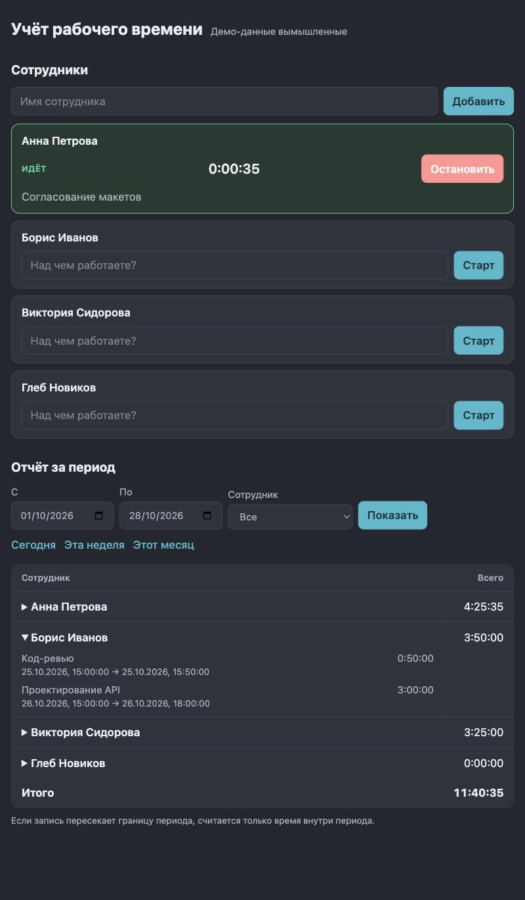

# Учёт рабочего времени

Небольшое веб-приложение для учёта рабочего времени сотрудников. Тестовое задание. Все данные в примерах вымышленные.



**Стек:** Python 3.11+, FastAPI, SQLite (стандартный модуль `sqlite3`), обычный HTML/CSS/JS без сборки.

## Что умеет

| Требование | Как сделано |
|---|---|
| Добавление сотрудников | Форма «Добавить». Дубли имён (без учёта регистра и лишних пробелов) отклоняются |
| Запуск и остановка таймера с описанием задачи | Карточка сотрудника: поле «Над чем работаете?» и кнопка «Старт». Пока таймер идёт, показывается живой счётчик и кнопка «Остановить» |
| Записи и общее время за период | Раздел «Отчёт за период»: выбор дат, быстрые кнопки «Сегодня / Эта неделя / Этот месяц», фильтр по сотруднику, у каждого сотрудника раскрывающийся список записей и сумма |
| Данные сохраняются после перезапуска | Всё лежит в файле SQLite, включая таймер, который идёт в момент остановки приложения |

## Запуск

### Локально

```bash
python3 -m venv .venv
source .venv/bin/activate          # Windows: .venv\Scripts\activate
pip install -r requirements.txt
uvicorn app.main:create_app --factory --port 8000
```

Открыть http://localhost:8000. Документация API (Swagger): http://localhost:8000/docs.

База создаётся сама в `data/timetracker.db`. Другой путь задаётся переменной окружения `TIMETRACKER_DB`.

Чтобы сразу увидеть заполненный интерфейс, можно добавить вымышленные демо-данные (если в базе уже есть сотрудники, скрипт ничего не делает):

```bash
python -m scripts.seed_demo
```

### Docker

```bash
docker build -t time-tracker .
docker run -p 8000:8000 -v time-tracker-data:/data time-tracker
```

База лежит в томе `/data`, поэтому переживает пересоздание контейнера. Это проверено вручную: создан сотрудник, контейнер удалён и запущен заново на том же томе, сотрудник на месте.

### Тесты

```bash
pip install -r requirements-dev.txt
python -m pytest
```

На каждый push тесты также запускает GitHub Actions (Python 3.11 и 3.14).

## API

| Метод и путь | Что делает | Ошибки |
|---|---|---|
| `GET /api/employees` | Сотрудники и их идущие таймеры, плюс время сервера | |
| `POST /api/employees` `{"name": "..."}` | Добавить сотрудника | 409 дубль, 422 пустое или слишком длинное имя |
| `POST /api/employees/{id}/timer/start` `{"description": "..."}` | Запустить таймер | 409 таймер уже идёт, 404 нет сотрудника, 422 пустое описание |
| `POST /api/employees/{id}/timer/stop` | Остановить таймер, вернуть запись | 409 таймер не запущен, 404 нет сотрудника |
| `GET /api/report?from=...&to=...&employee_id=...` | Отчёт за период `[from, to)`. Время обязательно с часовым поясом, например `2026-10-01T00:00:00Z`. `employee_id` необязателен | 422 неверный период, 404 нет сотрудника |

Все ошибки возвращаются как `{"detail": "понятный текст"}`, интерфейс показывает этот текст как есть.

## Как устроено и почему

```
app/
  main.py      HTTP: маршруты FastAPI, перевод исключений в ответы, раздача фронтенда
  service.py   вся бизнес-логика, ничего не знает про HTTP
  db.py        схема SQLite и подключение
  schemas.py   схемы запросов и ответов
  static/      index.html, style.css, app.js
tests/         pytest
scripts/       демо-данные
```

Ключевые решения:

- **Один идущий таймер на сотрудника гарантирует сама база.** В схеме есть частичный уникальный индекс `ON time_entries(employee_id) WHERE stopped_at IS NULL`. Код не делает «сначала проверю, потом вставлю», поэтому два одновременных запроса «Старт» не смогут создать два таймера: второй получит `IntegrityError`, API превращает его в 409.
- **Время хранится в UTC целыми секундами.** Никаких строк с датами и разных форматов, значения сравниваются как числа.
- **Период полуоткрытый `[from, to)`, а границы дней считает браузер.** Пользователь выбирает даты по своему календарю, браузер превращает их в точные моменты: начало дня «С» и начало дня после «По». Так отчёт не зависит от часового пояса сервера и корректно работает вокруг полуночи.
- **Запись на границе периода делится.** Если задача шла с 23:00 до 01:00, то в отчёт за первый день попадёт один час, за второй день тоже один. Идущий таймер считается до «сейчас», а не до конца периода.
- **Дубли имён ищутся через `casefold()`, а не `COLLATE NOCASE`.** Встроенное сравнение SQLite без учёта регистра работает только для латиницы: «анна» и «Анна» оно считает разными именами.
- **Часы можно подменить.** `create_app(db_path, clock)` принимает функцию времени, поэтому тесты сами решают, сколько секунд «прошло», и не используют `sleep`.
- **В интерфейсе нет `innerHTML`.** Весь текст пользователя вставляется через `textContent`, поэтому имя вида `` не выполнится.
- **Живой счётчик не перерисовывает карточки.** Каждую секунду обновляются только цифры, иначе сбивался бы ввод в соседних полях. Недописанные описания задач, кроме того, запоминаются, пока обновляется список.

## Проверки

27 тестов, около полусекунды. Что покрыто:

| Сценарий | Тесты |
|---|---|
| **Повторный запуск таймера** | `test_second_start_while_running_is_rejected`: второй старт даёт 409, идёт именно первая задача, запись одна. Также `test_one_running_timer_is_enforced_by_the_database_itself` (запрет работает на уровне базы) и проверка 409 после перезапуска приложения |
| **Пустой отчёт** | `test_empty_report_without_employees`, `test_empty_report_when_no_entries_in_period`: нулевые суммы, пустые списки, 200 вместо ошибки |
| Остановка без запущенного таймера, двойная остановка | `test_stop_without_running_timer_is_rejected`, `test_double_stop_is_rejected` |
| Сохранение после перезапуска | `test_data_survives_restart`: сотрудник, завершённая запись и ещё идущий таймер переживают «перезапуск» (второй экземпляр приложения на том же файле базы) |
| Сумма по сотрудникам, фильтр по сотруднику | `test_totals_per_employee`, `test_report_for_single_employee` |
| Границы периода, идущий таймер, часовые пояса | `test_entry_crossing_period_boundary_is_split`, `test_entry_outside_period_is_not_counted`, `test_running_timer_is_counted_until_now`, `test_timezone_offsets_in_period_are_respected` |
| Некорректный ввод | пустые и слишком длинные имена, пустое описание, период «конец раньше начала», время без пояса, битый JSON, гигантские числа и даты |
| Откат системных часов | `test_clock_going_backwards_does_not_break_stop` |

**Проверка самих тестов.** Тесты, которые всегда зелёные, бесполезны, поэтому код был намеренно сломан шестью способами на копии проекта: убран уникальный индекс, убрано деление записи по границе периода, идущий таймер считался до конца периода, дубли имён стали учитывать регистр, убрана защита от отката часов, разрешён пустой период. Все шесть поломок были пойманы упавшими тестами.

Тесты проверяют API и базу, а интерфейс проверялся вручную в браузере (см. ниже). Автотестов на фронтенд нет.

## Использованные ИИ-инструменты и модели

- **Claude Code** (десктопное приложение), модель **Claude Sonnet 5.5** (`claude-sonnet-5-5`). Написал весь код, тесты и этот README, сам запускал `pytest`, сервер, Docker и проверки.
- **Встроенный браузер Claude Code.** Агент открывал работающее приложение, кликал по интерфейсу, читал консоль браузера, сетевые запросы и лог сервера.

Других моделей и инструментов не использовалось.

### Примеры запросов

Человек поставил модели одну задачу, остальные шаги агент выполнял сам. Поэтому ниже исходный запрос и задачи, которые агент ставил себе по ходу.

1. **Исходный запрос человека.** Текст тестового задания целиком (создать с нуля веб-приложение учёта рабочего времени, язык, стек и модели на выбор, сотрудники, таймер с описанием, записи и сумма за период, сохранение после перезапуска, README с описанием ИИ-инструментов и найденных ошибок, проверки повторного запуска таймера и пустого отчёта) и просьба выполнить задание, выложить результат в репозиторий на GitHub и сделать все шаги самому.

Дальше пункты плана агента, это пересказ, а не дословные реплики:

2. **Тесты раньше интерфейса.** Сначала схема, логика и API, затем тесты на обязательные сценарии (повторный старт, пустой отчёт, перезапуск), и только потом фронтенд.
3. **Проверка тестов мутациями.** Сломать код шестью способами на копии проекта и убедиться, что на каждую поломку падает хотя бы один тест. Так обнаружилась ошибка в самой проверке (п. 5 в таблице ниже).
4. **Проверка вживую.** Запустить сервер и пройти основной сценарий в браузере как пользователь: добавить сотрудника, запустить таймер, остановить, посмотреть отчёт, перезапустить сервер. Здесь найдена самая серьёзная ошибка (п. 1).
5. **Ревью собственного кода.** Отправить серверу кривые запросы (битый JSON, огромные числа, крайние даты) и посмотреть, нет ли ответов 500.

## Какие ошибки были найдены и исправлены

| № | Что было | Как найдено | Причина | Исправление и защита |
|---|---|---|---|---|
| 1 | В браузере отчёт показывал «Ошибка сервера (500)», список сотрудников при этом грузился. 23 теста были зелёными | Проверка вживую в браузере, трассировка в логе сервера | FastAPI открывает соединение SQLite в одном потоке, а обрабатывает запрос в другом, SQLite такое запрещает. Проявлялось через раз, в зависимости от того, какой поток попал запросу. `TestClient` ходит иначе и этого не показывал | `check_same_thread=False` в `db.connect` (соединение на каждый запрос своё и параллельно не используется). Тест `test_connection_can_be_used_from_another_thread` без исправления падает, с ним проходит. Параллельный тест рядом баг сам по себе не воспроизводит, это отмечено в его описании: он только дымовая проверка |
| 2 | `POST /api/employees/1000000000000000000000000000000/timer/stop` возвращал 500 | Ручная проверка граничных запросов | Python принимает целое любого размера, SQLite только 64-битное, получался `OverflowError` | Идентификатор в пути и в запросе ограничен диапазоном `1 .. 2^63-1`, вне диапазона 422. Тест `test_malformed_requests_get_readable_errors_not_500` |
| 3 | Период вида `from=0001-01-01T00:00:00+14:00` или `to=9999-12-31T23:59:59-12:00` давал 500. | Та же проверка | Дата со смещением часового пояса при сборке ответа выходила за допустимый диапазон лет | Период должен укладываться в 1970-2100, иначе 422 с понятным текстом. Тест `test_extreme_period_dates_give_422_not_500` |
| 4 | На битый JSON приходило «Проверьте поле: 1» | Та же проверка | Обработчик ошибок подставлял «имя поля» из позиции ошибки в тексте | Для таких случаев текст «формат запроса». Входит в тест из п. 2 |
| 5 | Первая попытка проверить защиту от отката часов показала «тесты не заметили поломку» | Мутационная проверка | Ошибка не в коде, а в самой проверке: подстановка попала в комментарий с тем же текстом, а не в SQL. Ложная тревога | Подстановка повторена на нужной строке, тест `test_clock_going_backwards_does_not_break_stop` корректно упал. Без `MAX(started_at, ?)` откат часов дал бы пользователю 500 |
| 6 | В первом варианте `main.py` тип зависимости был указан как `object`, импорт `datetime` лежал внутри функции, а приложение создавалось прямо при импорте модуля (при импорте в тестах создавался бы файл БД) | Чтение собственного кода до первого запуска | Черновик | Тип заменён на `sqlite3.Connection`, импорт поднят наверх, приложение теперь собирается фабрикой `create_app` (запуск с `--factory`) |
| 7 | В раскрытом списке записей длительности не прижимались к краю колонки | Скриншот в браузере | CSS, колонка таблицы не растягивалась | Задана ширина колонке с итогом |

Ловушка, которую обошли заранее и покрыли тестом: `COLLATE NOCASE` в SQLite не понимает кириллицу (см. выше). Поломка этого места проверена мутацией.

## Известные ограничения

- Живой счётчик на экране может отставать от реального до 2 секунд: сервер хранит секунды, время округляется вниз с двух сторон. Итоговую длительность записи всегда считает сервер, поэтому отчёты точные.
- Нет редактирования и удаления сотрудников и записей, авторизации и ролей: по условию задания они не нужны.
- Имя сотрудника хранится так, как введено: «дарья козлова» не превращается в «Дарья Козлова».
- SQLite рассчитана на один сервер и небольшую нагрузку. Для команды из десятков человек этого достаточно, для большего стоило бы перейти на PostgreSQL (схема и логика от этого почти не изменятся).
- Автотестов на фронтенд нет, он проверялся вручную в браузере (десктоп и ширина 375 px, светлая и тёмная тема подхватываются системной настройкой).
