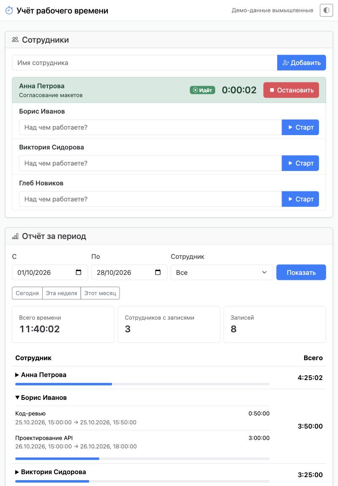
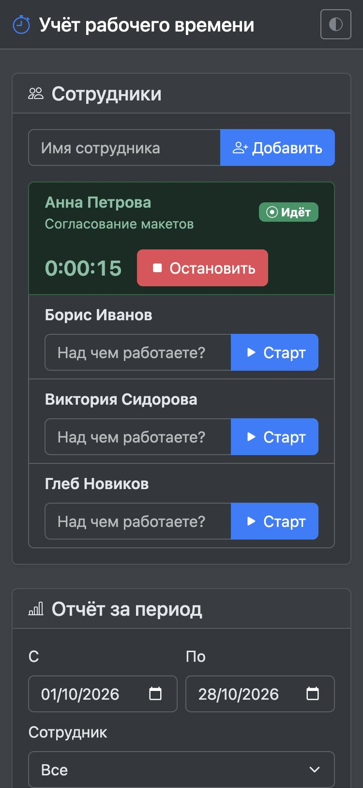

# Учёт рабочего времени

[](https://github.com/devbelek/time-tracker/actions/workflows/tests.yml)

Веб-приложение для учёта рабочего времени сотрудников: добавить сотрудника, запустить и остановить таймер с описанием
задачи, посмотреть записи и общее время за период. Данные сохраняются в файле и переживают перезапуск.
Тестовое задание, все данные в примерах вымышленные.

<p>
  
  
</p>

**Стек:** Python 3.11+, FastAPI, SQLite, HTML + Bootstrap 5 + ES-модули без сборки. Всё работает без интернета:
библиотеки лежат в репозитории.

## Содержание

- [Быстрый старт](#быстрый-старт)
- [Соответствие заданию](#соответствие-заданию)
- [Как устроено](#как-устроено)
- [Проверки качества](#проверки-качества)
- [API](#api)
- [Использование ИИ](#использование-ии)
- [Найденные и исправленные ошибки](#найденные-и-исправленные-ошибки)
- [Ограничения](#ограничения)

## Быстрый старт

Нужен Python 3.11 или новее.

```bash
git clone https://github.com/devbelek/time-tracker.git
cd time-tracker
python3 -m venv .venv
source .venv/bin/activate          # Windows: .venv\Scripts\activate
pip install -r requirements.txt
python -m scripts.seed_demo        # по желанию: вымышленные сотрудники и записи
uvicorn app.main:create_app --factory --port 8000
```

Открыть http://localhost:8000. Документация API (Swagger): http://localhost:8000/docs.
База создаётся сама в `data/timetracker.db`, другой путь задаётся переменной `TIMETRACKER_DB`.

Короче через `make` (после `make install`): `make run`, `make seed`, `make check`. Полный список: `make help`.

**Docker:**

```bash
docker compose up --build
```

База лежит в томе, поэтому переживает пересоздание контейнера (проверено вручную: создан сотрудник, контейнер удалён и
запущен заново, сотрудник на месте). В образе есть `HEALTHCHECK` по `/health`.

## Соответствие заданию

| Что просили | Как сделано | Где проверить |
|---|---|---|
| Добавление сотрудников | Форма «Добавить». Дубли имён отклоняются без учёта регистра и лишних пробелов, в том числе для кириллицы | `tests/test_employees.py`, `tests/test_domain.py` |
| Запуск и остановка таймера с описанием | Карточка сотрудника: поле задачи и «Старт», затем живой счётчик и «Остановить». Один идущий таймер на сотрудника гарантирует база | `tests/test_timer.py`, `tests/e2e/test_ui.py` |
| Записи и общее время за период | Отчёт с выбором дат, быстрыми периодами, фильтром по сотруднику, раскрывающимся списком записей и долей от общего времени | `tests/test_report.py`, `tests/test_domain.py` |
| Сохранение после перезапуска | SQLite-файл, идущий таймер тоже переживает перезапуск | `tests/test_persistence.py`, e2e с реальным перезапуском сервера |
| **Повторный запуск таймера** | Второй старт даёт 409 и понятное сообщение, состояние не портится. Работает и при двух вкладках | `test_second_start_while_running_is_rejected`, `test_one_running_timer_is_enforced_by_the_database_itself`, `test_repeated_start_from_a_stale_tab_shows_error_and_current_state` |
| **Пустой отчёт** | Нулевые суммы и пустые списки вместо ошибки, в интерфейсе понятный текст | `test_empty_report_*`, `test_empty_report_for_period_without_entries` |
| README: запуск, ИИ-инструменты, примеры запросов, найденные ошибки | Разделы [Быстрый старт](#быстрый-старт), [Использование ИИ](#использование-ии), [Найденные ошибки](#найденные-и-исправленные-ошибки) | этот файл |
| Понятный код | Четыре слоя с односторонними зависимостями, `ruff` и `mypy --strict` без замечаний, подробная схема в [docs/ARCHITECTURE.md](docs/ARCHITECTURE.md) | `make lint types` |
| Способность объяснить и доработать | Причины решений ниже и в архитектурном документе, таблица «как расширять» | [docs/ARCHITECTURE.md](docs/ARCHITECTURE.md) |

## Как устроено

```
app/
  main.py        сборка приложения, обработка ошибок, заголовки безопасности, /health
  api.py         HTTP-маршруты (тонкий слой)
  schemas.py     формат запросов и ответов
  service.py     сценарии: добавить сотрудника, старт, стоп, отчёт
  domain.py      чистые правила, типы и ошибки (без SQL и HTTP)
  repository.py  весь SQL
  db.py          соединение и версионные миграции
  config.py      настройки из окружения
  static/        index.html, js/ (ES-модули), css/, vendor/ (Bootstrap)
tests/           pytest: юнит, свойства, API, миграции; e2e/ (Playwright)
tests-js/        node --test: чистая логика фронтенда
scripts/         демо-данные
```

Зависимости идут только вниз: `api → service → domain` и `service → repository → db`. Подробная схема с диаграммами,
моделью данных и последовательностью запроса: [docs/ARCHITECTURE.md](docs/ARCHITECTURE.md).

Ключевые решения и причины:

- **Один идущий таймер на сотрудника гарантирует сама база.** В схеме частичный уникальный индекс
  `ON time_entries(employee_id) WHERE stopped_at IS NULL`. Код не делает «проверю, потом вставлю»: между проверкой и
  вставкой всегда успевает вклиниться второй запрос. Вместо этого вставка просто пробуется, а отказ базы превращается
  в 409.
- **Время хранится в UTC целыми секундами.** Никаких строк с датами, значения сравниваются как числа.
- **Период полуоткрытый `[from, to)`, границы дней считает браузер.** Пользователь выбирает дни по своему календарю,
  на сервер уходят точные моменты. Поэтому отчёт не зависит от часового пояса сервера, а сутки в 23 и 25 часов (переход на
  летнее время) работают без особых случаев. Это проверено тестами при `TZ=America/New_York`.
- **Запись на границе периода делится.** Задача с 23:00 до 01:00 даёт по часу в каждые сутки. Свойство «отчёт за
  `[a, c)` равен сумме отчётов за `[a, b)` и `[b, c)`» проверяется на сотнях случайных наборов записей.
- **Дубли имён ищутся через `casefold()`, а не `COLLATE NOCASE`.** Встроенное сравнение SQLite без учёта регистра
  работает только для латиницы: «анна» и «Анна» оно считает разными.
- **Часы подменяются.** `create_app(settings, clock=...)` принимает функцию времени, поэтому тесты сами решают, сколько
  секунд «прошло», и не используют `sleep`.
- **Версионные миграции.** Версия схемы в `PRAGMA user_version`, миграция и повышение версии в одной транзакции. База
  от более новой версии приложения отклоняется, а не портится.
- **Фронтенд без сборки, но не «спагетти».** Разметка с Bootstrap живёт в `index.html` (шаблоны `<template>`), JS разбит
  на модули, логика дат вынесена в чистые функции с тестами. Текст пользователя вставляется только через `textContent`.
- **Строгая политика безопасности.** `Content-Security-Policy: default-src 'self'` без `unsafe-inline`.

## Проверки качества

Автоматических проверок в сумме больше 90, все запускаются в GitHub Actions пятью независимыми задачами.

| Проверка | Что делает | Команда |
|---|---|---|
| Линтер и формат | `ruff`: ошибки, порядок импортов, упрощения, типичные баги | `make lint` |
| Типы | `mypy --strict` по `app/` и `scripts/` | `make types` |
| Тесты Python | 61 тест: юнит, API, миграции, health, заголовки безопасности. Покрытие 99,7% (порог 95%) | `make test` |
| Свойства (hypothesis) | отчёт аддитивен по границам периода, пересечение не выходит за запись и окно | входит в `make test` |
| Тесты фронтенда | 13 тестов `node --test`: форматирование, границы суток в разных часовых поясах, переход на летнее время | `make js-test` |
| Сквозные тесты | 17 сценариев в настоящем Chromium: весь путь пользователя, перезапуск сервера, два окна, XSS, темы, мобильная ширина, отсутствие ошибок в консоли и нарушений CSP | `make e2e` |
| Docker | сборка образа и ответ `/health` из контейнера | задача `docker` в CI |

Сквозные тесты требуют `make install-e2e` (Playwright и Chromium), поэтому обычный `pytest` их пропускает.

**Проверка самих тестов.** Тест, который всегда зелёный, бесполезен, поэтому код намеренно ломался на копии проекта
24 способами: 16 в серверном коде и 8 во фронтенде. Например: убран уникальный индекс, убрана обрезка записи по границе
периода (слева и справа), идущий таймер считался до конца периода, дубли имён стали учитывать регистр, миграция
перестала повышать версию, не выполнялся откат неудачной миграции, исчез заголовок CSP, имена вставлялись через
`innerHTML`, у периода пропал «+1 день» на правой границе. Каждая поломка поймана упавшим тестом. Одна мутация (гонка при
вводе имени) с первого раза прошла незамеченной, из-за чего тест пришлось переписать, см. ошибку 10 ниже.

## API

| Метод и путь | Что делает | Ошибки |
|---|---|---|
| `GET /api/employees` | Сотрудники, их идущие таймеры и время сервера | |
| `POST /api/employees` `{"name": "..."}` | Добавить сотрудника | 409 дубль, 422 пустое или длинное имя |
| `POST /api/employees/{id}/timer/start` `{"description": "..."}` | Запустить таймер | 409 уже идёт, 404, 422 |
| `POST /api/employees/{id}/timer/stop` | Остановить таймер, вернуть запись | 409 не запущен, 404 |
| `GET /api/report?from=...&to=...&employee_id=...` | Отчёт за `[from, to)`. Время обязательно с поясом, например `2026-10-01T00:00:00Z` | 422 неверный период, 404 |
| `GET /health` | Живость и версия схемы БД | 503, если база недоступна |

Ошибки возвращаются как `{"detail": "понятный текст"}`, интерфейс показывает этот текст как есть.

## Использование ИИ

**Инструменты и модели.**

- **Claude Code** (десктопное приложение), модель **Claude Sonnet 5.5** (`claude-sonnet-5-5`). Написал код, тесты,
  документацию, сам запускал проверки, сервер и Docker.
- **Встроенный браузер Claude Code.** Агент открывал работающее приложение, кликал по интерфейсу, читал консоль,
  сетевые запросы и лог сервера.

Других моделей и ИИ-инструментов не использовалось. Playwright, hypothesis и ruff это обычные программные
инструменты, не ИИ.

**Примеры запросов.** Человек поставил модели две задачи, дальнейшие шаги агент выполнял сам.

1. **Исходная задача.** Текст тестового задания целиком (приложение учёта рабочего времени с нуля, стек и модели на
   выбор, сотрудники, таймер с описанием, записи и сумма за период, сохранение после перезапуска, README с описанием
   ИИ и найденных ошибок, проверки повторного запуска и пустого отчёта) и просьба выполнить его и выложить результат
   в репозиторий на GitHub, всё необходимое сделав самому.
2. **Доработка.** Просьба довести проект до уровня, который уверенно пройдёт проверку: дизайн на готовых библиотеках,
   продуманная архитектура.

Дальше пункты плана самого агента, это пересказ, а не дословные реплики:

- **Тесты раньше интерфейса.** Сначала схема, логика и API, затем тесты на обязательные сценарии, потом фронтенд.
- **Проверка тестов мутациями.** Сломать код на копии проекта и убедиться, что на каждую поломку падает тест.
- **Проверка вживую.** Запустить сервер и пройти основной сценарий в браузере как пользователь, включая перезапуск.
- **Ревью собственного кода.** Отправить серверу кривые запросы (битый JSON, огромные числа, крайние даты) и
  посмотреть, нет ли ответов 500.
- **Сквозные тесты по найденному.** Каждый сценарий, на котором в браузере что-то ломалось, закрепляется тестом.

**Как проверялся результат работы ИИ.** Код модели не принимался на веру. Каждое утверждение в этом README подкреплено
запуском: тесты, мутации, реальный браузер, реальный Docker. Ниже ошибки, которые это нашло. Большинство не видны в
тестах «зелёного пути», их нашли только живая проверка и целенаправленный перебор плохого ввода.

## Найденные и исправленные ошибки

| № | Что было | Как найдено | Причина | Исправление и защита от повтора |
|---|---|---|---|---|
| 1 | В браузере отчёт показывал «Ошибка сервера (500)», список сотрудников при этом грузился. 23 теста были зелёными | Живая проверка в браузере и трассировка в логе сервера | FastAPI открывает соединение SQLite в одном потоке, а обрабатывает запрос в другом, SQLite такое запрещает. Проявлялось через раз. `TestClient` ходит иначе и этого не показывал | `check_same_thread=False` в `db.connect` (соединение на каждый запрос своё и параллельно не используется). Тест `test_connection_can_be_used_from_another_thread` без исправления падает. Параллельный тест рядом баг сам по себе не воспроизводит, это сказано в его описании |
| 2 | `POST /api/employees/1000000000000000000000000000000/timer/stop` возвращал 500 | Ручной перебор плохих запросов | Python принимает целое любого размера, SQLite только 64-битное: `OverflowError` | Идентификаторы ограничены `1 .. 2^63-1`, вне диапазона 422 |
| 3 | Период вроде `from=0001-01-01T00:00:00+14:00` или `to=9999-12-31T23:59:59-12:00` давал 500 | То же | Дата со смещением выходила за допустимый диапазон лет при сборке ответа | `Period` отклоняет периоды вне 1970-2100 с понятным текстом. Тест `test_extreme_period_dates_give_422_not_500` |
| 4 | На битый JSON приходило «Проверьте поле: 1» | То же | Обработчик ошибок подставлял «имя поля» из позиции ошибки в тексте | Для таких случаев текст «формат запроса» |
| 5 | Первая мутационная проверка защиты от отката часов показала «тесты поломку не заметили» | Мутационная проверка | Ошибка не в коде, а в самой проверке: подстановка попала в комментарий с тем же текстом, а не в SQL | Подстановка повторена на нужной строке, тест корректно упал. Без `MAX(started_at, ?)` откат часов дал бы пользователю 500. После этого проверка подстановок требует ровно одно совпадение |
| 6 | Ответ сервера на «Добавить» стирал имя следующего сотрудника, которое успели начать вводить | Сквозной тест в браузере (два добавления подряд) | Поле очищалось после ответа сервера, а не при отправке. На медленной сети окно гонки заметно | Поле очищается сразу, при ошибке введённое возвращается. Тест `test_typing_next_name_while_previous_request_is_in_flight_is_not_erased` |
| 7 | Отчёт с записью нулевой длины (старт и сразу стоп) писал «записей нет» при ненулевом числе записей | Разбор граничных случаев при проектировании сквозных тестов, до публикации | Условие проверяло нулевую сумму вместо числа записей | Условие по числу записей, тест `test_entry_with_zero_duration_is_not_reported_as_missing` |
| 8 | Дата `2026-02-30` молча превращалась во 2 марта, а год `0026` в 1926 | Написание тестов границ периода | Особенности `Date` в JavaScript (переполнение дня, годы 0..99 как 1900..1999) | Строгий разбор через `setFullYear` и проверка совпадения месяца и дня. 13 тестов `tests-js/` |
| 9 | Обычный `pytest` падал на сборе тестов после добавления папки `tests/e2e` | Прогон после добавления | Два файла `conftest.py` конфликтуют при `from conftest import ...` | Общие помощники вынесены в `tests/helpers.py` |
| 10 | Тест на гонку из п. 6 пропускал вернувшуюся поломку: он падал на старом коде лишь случайно | Мутационная проверка фронтенда | Тест вводил два имени подряд и зависел от скорости ответа сервера | Ответ сервера теперь удерживается перехватом запроса Playwright, пока тест вводит следующее имя. Проверено: тест падает на старом коде и проходит на новом |

## Ограничения

- Живой счётчик на экране может отставать от реального до 2 секунд: сервер хранит секунды, время округляется вниз с
  двух сторон. Итоговую длительность записи всегда считает сервер, поэтому отчёты точные.
- Нет редактирования и удаления сотрудников и записей, авторизации и ролей: по условию задания они не нужны.
  Для публичного развёртывания авторизацию нужно добавить перед сервисом.
- Имя сотрудника хранится так, как введено: «дарья козлова» не превращается в «Дарья Козлова».
- SQLite рассчитана на один сервер и небольшую нагрузку. Для команды из десятков человек этого достаточно, для
  большего стоило бы перейти на PostgreSQL: замена затрагивает только `db.py` и `repository.py`.
- Сквозные тесты запускаются в Chromium. В Firefox и Safari интерфейс вручную не проверялся.

## Лицензии

Код проекта под лицензией MIT ([LICENSE](LICENSE)). Сторонние файлы (Bootstrap 5.3.8 и Bootstrap Icons 1.13.2, обе
MIT) описаны в [app/static/vendor/README.md](app/static/vendor/README.md).
