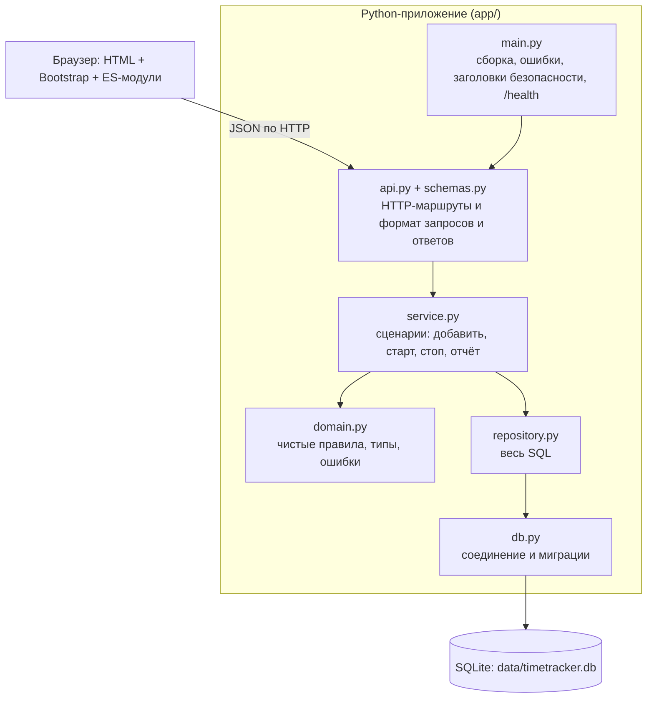
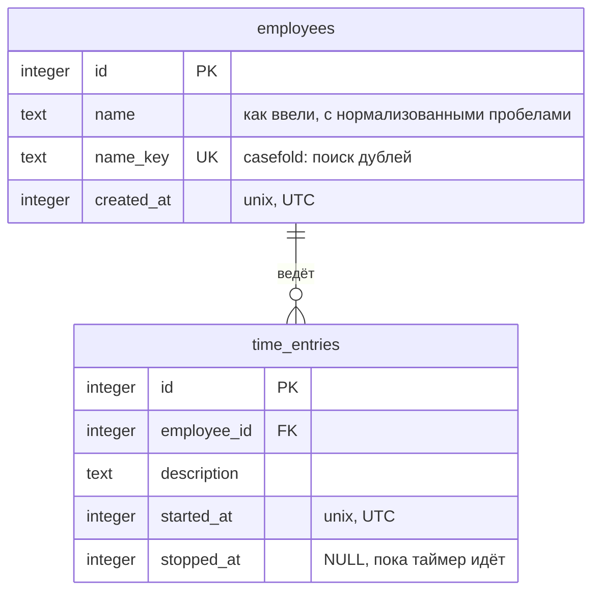
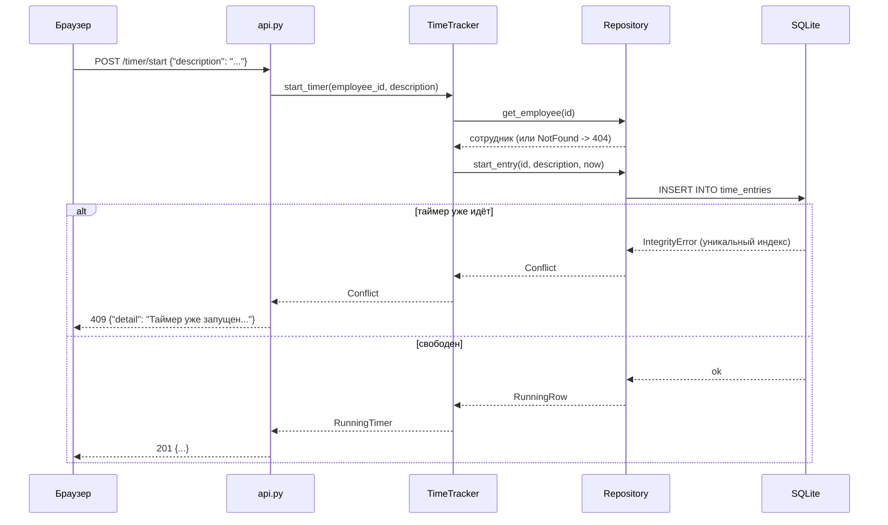

# Архитектура

Приложение небольшое, поэтому слоёв ровно столько, сколько нужно, чтобы каждый можно было менять и проверять отдельно.

## Слои

Зависимости направлены только вниз. `domain.py` ничего не знает про SQL и HTTP, поэтому его правила
(деление записи по границе периода, проверка периода, нормализация имён) проверяются быстрыми юнит-тестами и
проверками свойств без базы.

| Слой | Ответственность | Чего здесь быть не должно |
|---|---|---|
| `api.py`, `schemas.py` | разобрать запрос, вызвать сценарий, вернуть ответ; валидация формата | бизнес-правил, SQL |
| `service.py` | сценарии использования, чтение часов, логирование событий | SQL, знания про HTTP |
| `domain.py` | правила и типы: `Period`, `overlap_seconds`, `name_key`, ошибки | ввода-вывода любого вида |
| `repository.py` | SQL и перевод ошибок БД в ошибки предметной области | бизнес-правил |
| `db.py` | подключение, миграции схемы | запросов приложения |

## Модель данных

Правила, которые держит сама база, а не код приложения:

- `UNIQUE INDEX ... ON time_entries(employee_id) WHERE stopped_at IS NULL`: не больше одного идущего таймера на сотрудника;
- `CHECK (stopped_at IS NULL OR stopped_at >= started_at)`: запись не может закончиться раньше начала;
- `UNIQUE (name_key)`: нет двух сотрудников с одним именем;
- внешний ключ `employee_id` (включён `PRAGMA foreign_keys`).

## Как проходит запрос

Повторный запуск таймера: проверка живёт в базе, код только переводит её отказ в понятный ответ.

Принцип: не «сначала проверю, потом вставлю», а «вставлю и посмотрю, что скажет база». Между проверкой
и вставкой всегда есть окно, в которое успевает вклиниться второй запрос.

## Время

- Всё хранится в UTC целыми секундами.
- Период отчёта полуоткрытый, `[from, to)`. Границы дней считает браузер по местному календарю и присылает точными
  моментами времени, поэтому сутки в 23 или 25 часов (переход на летнее время) работают без особых случаев на сервере.
- Запись, пересекающая границу периода, делится: в сумму идёт только время внутри периода.
  Свойство «отчёт за `[a, c)` равен сумме отчётов за `[a, b)` и `[b, c)`» проверяется на случайных данных.
- Идущий таймер считается до «сейчас» по часам сервера. Часы подменяются через `create_app(clock=...)`, поэтому
  тесты не используют `sleep`.

## Миграции

Версия схемы хранится в `PRAGMA user_version`. Миграции это список SQL-скриптов в `db.py`, каждый применяется один раз
и в одной транзакции вместе с повышением версии. Первая миграция написана через `IF NOT EXISTS`, чтобы подхватить базы,
созданные до появления версионирования. Это покрыто тестом на «старой» схеме. База от более новой версии
приложения отклоняется с понятной ошибкой, а не портится молча.

## Безопасность

- Весь SQL с параметрами, строки в запросы не подставляются.
- Пользовательский текст в интерфейсе вставляется через `textContent`, никакого `innerHTML`.
- Заголовок `Content-Security-Policy: default-src 'self'` без `unsafe-inline`: поэтому в разметке нет встроенных
  скриптов и стилей, а библиотеки лежат в репозитории (`app/static/vendor/`).
- Идентификаторы в путях ограничены диапазоном 64-битного целого, период отчёта диапазоном 1970-2100.
  Обе границы нашлись как реальные ошибки 500, см. README.
- Авторизации нет по условию задания. Для публичного развёртывания её нужно добавить перед сервисом.

## Как расширять

| Задача | Где менять |
|---|---|
| Редактирование записи | метод в `Repository`, сценарий в `TimeTracker`, маршрут в `api.py`. Правило «запись не пересекается с другими» в `domain.py` |
| Новая колонка | новый элемент в `MIGRATIONS` (старые не менять), поле в `schemas.py` |
| Другая СУБД | заменить `db.py` и `repository.py`, остальные слои не меняются |
| Авторизация | зависимость FastAPI на уровне `include_router`, сценарии не затрагиваются |
